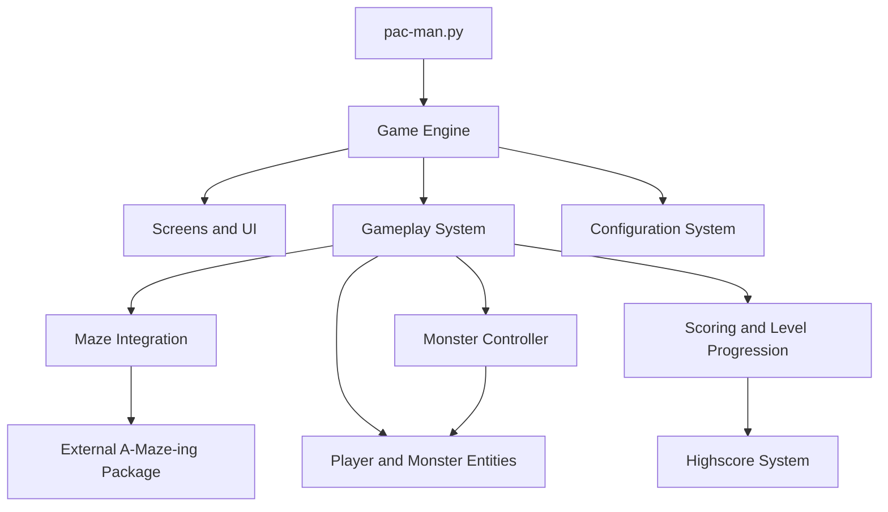

*This activity has been created as part of the 42 curriculum by mabu-are, aabtah.*

# Pac-Man — A-Maze-ing Integration (Minecraft Style)

A Python implementation of the classic Pac-Man arcade game, combining procedural maze generation, object-oriented game architecture, autonomous monsters, persistent highscores, and a Minecraft-inspired visual style.

The project uses the externally assigned **A-Maze-ing** package to generate playable mazes and transforms the traditional Pac-Man experience into a block-based adventure.

## Description

The goal of this project is to build a complete and playable Pac-Man game while applying object-oriented programming, modular software design, external package integration, configuration management, and persistent data storage.

The game features a Minecraft-inspired environment in which the player navigates generated mazes, collects pacgums, avoids monsters, and progresses through increasingly challenging levels.

## Features

- **Minecraft-inspired graphics:** Block-based visual elements and a custom visual identity.
- **Procedural maze generation:** Integration with the assigned external A-Maze-ing package.
- **Progressive levels:** Multiple levels with seed-based and randomized maze generation.
- **Monster AI:** Four Minecraft-themed monsters with different target-selection behaviors.
- **Power-ups:** Super-pacgums trigger the frightened state and allow the player to eat monsters.
- **Scoring system:** Points for collecting pacgums and eating monsters.
- **Persistent highscores:** Local JSON-based leaderboard that stores the top 10 scores.
- **Configurable gameplay:** Game parameters are loaded from a JSON configuration file that supports comments.
- **Error handling:** Invalid or missing configuration and highscore data are handled with safe fallbacks.
- **Cheat mode:** Additional functionality intended to facilitate project review.

## Instructions

### Prerequisites

The project requires:

- Python version compatible with the requirement declared in `pyproject.toml`.
- `make`.
- The dependencies declared by the project.
- The assigned A-Maze-ing package.

A Python virtual environment is recommended.

### Installation

Clone the repository:

```bash
git clone <repository_url>
cd Pacman
```

Install the project dependencies using the provided Makefile:

```bash
make install
```

If the external maze generator package is distributed separately, make sure it is available in the environment according to the project's dependency configuration.

### Running the Game

Run the game using the Makefile:

```bash
make run
```

The project also supports launching the main script directly with a configuration file:

```bash
python3 pac-man.py config.json
```

Use the command and configuration format supported by the current project implementation.

### Available Make Commands

| Command | Description |
|---|---|
| `make install` | Creates the project environment and installs dependencies. |
| `make run` | Launches the game. |
| `make debug` | Runs the game using Python's debugger. |
| `make lint` | Runs the configured static analysis tools. |
| `make clean` | Removes temporary files, caches, and build artifacts. |
| `make help` | Displays available Makefile targets. |

### Controls

The game provides keyboard-based controls for navigating the player and interacting with the menus.

For the exact key bindings, use the in-game instructions screen. This section should be updated if the controls change.

## Configuration

The game uses `config.json` to customize gameplay parameters.

The configuration format supports comments beginning with `#`.

The following options are documented by the current project README:

| Key | Description | Documented Default |
|---|---|---:|
| `highscore_filename` | File used to store persistent highscores. | `highscores.json` |
| `lives` | Initial number of player lives. | `3` |
| `points_per_pacgum` | Points awarded for collecting a regular pacgum. | `10` |
| `points_per_super_pacgum` | Points awarded for collecting a super-pacgum. | `50` |
| `points_per_ghost` | Base points awarded for eating a monster. | `200` |
| `seed` | Initial seed used for level generation. | `42` |
| `level_max_time` | Maximum time allowed for a level, in seconds. | `90` |

Refer to `config.json` and the configuration loader for the definitive list of supported keys and defaults.

### Faulty Configuration Handling

The configuration system is designed to handle missing or invalid values without terminating the game.

When an invalid or missing value is encountered, the application uses safe defaults and reports the issue.

Unknown configuration keys should not interfere with the application's execution.

## Gameplay

### Core Gameplay Loop

The player navigates a generated maze, collects pacgums, avoids monsters, and attempts to complete each level before the time limit expires.

Collecting all required pacgums allows the player to progress to the next level.

The game tracks the player's score, remaining lives, current level, and remaining time.

### Player

The player moves through the maze grid and must navigate around walls while collecting pacgums.

Movement uses direction buffering so that a requested direction can be applied when the corresponding path becomes available.

### Monster Personalities

The game features four Minecraft-themed monsters with different target-selection strategies:

| Monster | Role | Behavior |
|---|---|---|
| BabyZombie | Chaser | Targets the player's current cell. |
| Skeleton | Ambusher | Targets cells ahead of the player's current direction. |
| Enderman | Pincer | Targets a position between the chaser and the player. |
| Witch | Coward | Wanders and changes behavior depending on its distance from the player. |

The monsters share a movement and pathfinding system while using different strategies to select their targets.

### Monster States

| State | Description |
|---|---|
| `CHASE` | The monster follows its target-selection strategy. |
| `FRIGHTENED` | Triggered by a super-pacgum. Monsters become edible and attempt to move away from the player. |
| `DEAD` | After being eaten, the monster returns to its spawn point and then respawns. |

### Hardcore Mode

The project includes a configurable hardcore mode with additional monster behaviors.

The documented behaviors include:

- BabyZombie moves faster than the player.
- Skeleton can shoot arrows through open corridors.
- Enderman can teleport to random open cells.
- Witch can slow the player using splash potions.

### Scoring

The scoring system rewards the player for collecting pacgums and eating monsters.

The configured scoring values are documented in the Configuration section. Monster-eating scores may increase through consecutive kills, depending on the active gameplay implementation.

### Level Progression

The project is designed around progressive levels.

The first level uses a deterministic seed, while subsequent levels can use randomized maze layouts. Each level has a configurable time limit.

## Highscore System

The game includes a persistent highscore system that records player achievements.

### Storage

Highscores are stored locally in a JSON file. The storage filename is configurable through `highscore_filename`.

### Validation

The documented player-name rules are:

- Maximum length of 10 characters.
- Alphanumeric characters and spaces only.

Scores are expected to be non-negative integers.

### Leaderboard

The system maintains the top 10 player scores and makes them available through the game's leaderboard interface.

### Design Choice

JSON was selected because it is lightweight, human-readable, and supported directly by Python.

It is appropriate for a local game leaderboard because it does not require a database server or additional infrastructure.

The storage implementation is designed to handle missing or invalid data safely.

## Maze Generation

The project integrates the externally assigned **A-Maze-ing** package to generate game levels.

The project does not replace the assigned package with a custom maze-generation implementation. Instead, it uses an integration layer to adapt the package's interface to the game's requirements.

### Non-Perfect Mazes

The integration uses:

```python
PERFECT = False
```

This setting is used to request maze layouts suitable for Pac-Man-style navigation, including alternative paths and loops.

### Seed Handling

The documented configuration uses seed `42` for the initial level.

Subsequent levels can use randomized seeds to provide variation between playthroughs.

### The 42 Pattern

The project documentation describes a central pattern representing `42` as part of the maze layout.

Its placement and behavior are handled by the game's maze integration and rendering logic.

The external generator remains a separate dependency and is not presented as code written by this project.

## Implementation

The game is implemented in Python and follows a modular, object-oriented approach.

Its main responsibilities are separated into systems for:

- Game lifecycle and state management.
- Gameplay rules and level progression.
- Player and monster entities.
- Monster AI and pathfinding.
- Maze generation integration.
- Graphics and user interface.
- Configuration management.
- Persistent highscore storage.

The source code is organized under the `game/` directory, with `pac-man.py` serving as the main entry point.

## General Software Architecture

The application separates game management, gameplay logic, entities, AI, and presentation to make the code easier to maintain and extend.

### Main Components

| Component | Responsibility |
|---|---|
| Main entry point | Starts the application and initializes the game. |
| Game engine | Manages the game window, clock, and application states. |
| Gameplay system | Handles level lifecycle, scoring, lives, timers, and pacgum placement. |
| Entity layer | Represents the player and monsters, including their movement and state. |
| Monster controller | Coordinates monster target selection and pathfinding. |
| Maze integration | Adapts the external A-Maze-ing package to the game's expected interface. |
| Graphics and screens | Renders the game world, menus, HUD, and interface elements. |
| Configuration system | Loads and validates gameplay settings. |
| Highscore system | Loads, validates, sorts, and saves player scores. |

### Architecture Diagram



The diagram represents the high-level responsibilities of the application. Individual module and class names should be checked against the source tree when making implementation changes.

## Project Management

The project was developed by a two-member team with responsibilities distributed across configuration, gameplay systems, maze integration, AI, rendering, and documentation.

Project planning, task organization, risk analysis, testing, and progress records are maintained in the dedicated directory:

[Project Management Documentation](./project_management/README.md)

The directory contains the project overview, timeline, team organization, risk analysis, test plan, progress report, and technical decisions.

## Resources

### References

- [Python Documentation](https://docs.python.org/3/)
- [Python Packaging User Guide](https://packaging.python.org/)
- [PEP 257 — Docstring Conventions](https://peps.python.org/pep-0257/)
- [Git Documentation](https://git-scm.com/doc)
- External A-Maze-ing package documentation and interface specifications supplied with the activity.

### AI Usage

AI tools were used as supporting resources during selected development and documentation tasks.

The documented areas of assistance include:

- Discussing software architecture and modular design.
- Reviewing configuration parsing and error-handling approaches.
- Exploring monster movement and pathfinding logic.
- Reviewing grid-based movement and collision concepts.
- Structuring and improving project documentation.

AI suggestions were treated as assistance rather than automatically accepted solutions. The team remains responsible for reviewing, testing, understanding, and explaining the final implementation.

## License

This project is distributed under the MIT License. See [LICENSE.md](./LICENSE.md) for details.
